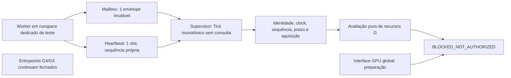

# WHAT LIES BTWN — Stage03I supervision decision package

PREPARED_WITH_LIMITATIONS / PROPOSED_ONLY. G4/G5/Alpha/MCP fechados.
Nenhuma decisão deste pacote constitui consentimento ou ativação operacional.

## Arquitetura entregue

O módulo novo não cria runspace, processo ou listener automaticamente. O harness
de testes cria runspaces benignos no processo PowerShell do observador e aguarda
somente sua conclusão natural. O supervisor não chama sampler nem aguarda sua
query. Comunicação in-process preparada/medida; IPC cross-process, isolamento de
crash e cleanup/cancelamento real não estão implementados. A opção por runspace
cumpre independência lógica desta etapa, sem alegar isolamento de processo.

## Contrato de envelope e mailbox

Envelope sealed com properties get-only: fingerprint PID/creation/image/hash do
worker, clock ID de sessão, evidence kind, sequência principal/slow, request start,
aquisição fast/slow, conclusão, generation verification status e JSON serializado.
JSON é snapshot profundo em string imutável: mutar o objeto original não altera
o envelope. Payload<=65536 bytes UTF-8; fingerprint64 hex; clock<=128 caracteres.
O limite é de payload/transporte, não hard cap de heap/provider durante coleta.

Capacity1: publicação em slot ocupado falha e mantém fault latched; não substitui
valor pendente. Take não bloqueante; lock busy também bloqueia conservadoramente.
Sem polling de query dentro do lock, retries, growth ou descarte silencioso de
overflow. Heartbeat é um segundo slot fixo, não fila: conserva sequência/clock,
failed event latched, e não altera timestamps de aquisição do envelope.
Context retém apenas últimas referências de envelope/receipt e counters; não
mantém histórico ilimitado. Histórico de testes é finito no namespace StageI.

| Tempo/identidade | Semântica e validação |
| --- | --- |
| RequestStartedMs | Início da chamada de coleta atual no QPC local |
| FastAcquiredMs | Bound conservador anterior à consulta fast; nunca o instante de chegada |
| SlowAcquiredMs/SlowSequence | Originais da leitura slow; cache conserva ambos |
| AcquisitionStartedMs | min(fast,slow), usado no freshness candidato2000 ms |
| CollectionCompletedMs/CollectionDurationMs | Fim e fim-request, sem confundir cache age com duração atual |
| ObservedReceivedMs | Receipt do envelope observado, inclusive quando recusado |
| SupervisorReceivedMs | Receipt do último envelope aceito somente como metadata de preparação |
| ReceiptAgeMs | Idade desse receipt; não prova frescor de fonte |
| Provider generation | UNKNOWN em consultas passivas; nunca promovido por receipt/heartbeat |
| DeadlineMs | started+120000; Tick>=deadline bloqueia, mesmo com amostra recente |
| Worker fingerprint | Observação exata de PID/criação/imagem/hash; não ownership de lançamento/parada |

Payload bridge rejeita JSON malformado, duplicate/case-colliding keys, tipos,
clock/timestamps divergentes do envelope e identidade de processo divergente.
Para compatibilidade com G, payload.collection_ms é intervalo entre a aquisição
mais antiga e conclusão do merge; inclui cache quando assinalado. Duração da
chamada atual está em Envelope.CollectionDurationMs. Não confundir os dois.
Relógio/clock ID são de sessão QPC no mesmo processo; bridge entre processos não
foi implementado nem implicitamente aceito.

## Estados e evidência de independência

State externo é sempre BLOCKED_NOT_AUTHORIZED. METADATA_VALID_PREPARATION_ONLY
não aprova startup. Missing data mantém waiting/sem autoridade e, após idade
excedida, bloqueia terminalmente; heartbeat/data failure, unknown generation,
overflow, replay/sequence/clock e deadline também bloqueiam. Não há resume/retry
automático de contexto terminal. Tick precisa continuar sendo agendado pelo
caller; isolamento de falha do host/scheduler não foi provado.

Teste final em tempo real, com query simulada finita2800 ms: supervisor bloqueou
em2004 ms, antes de o worker concluir naturalmente. Tick máximo0,2601 ms nesse
experimento. Isso demonstra lógica independente no cenário testado; não é
watchdog de ComfyUI, query nativa realmente hung, SLA ou hard bound de latência.
O deadline120s foi testado com relógio injetado, sem executar runtime por120s.

Coleta real final cold914 ms: envelope23.222–23.223 bytes, source age UNKNOWN,
supervisor bloqueou com PROVIDER_GENERATION_AGE_UNKNOWN. Timing neutral consumer
recebeu4 envelopes (slow sequences1,1,2,2), acquisition age máximo567 ms. Este
consumer mede transporte/cache; não constitui exceção ao supervisor estrito.
CPU combinada parent+worker~91,3% de um core nessa janela curta; não CPU global.

## GPU proxy preparado e não aprovado

Test-WlbPreparedGpuProxy verifica RTX name/UUID/driver/index/total estáveis,
baseline imediato conforme anchor do teste, global delta<=2 GiB, counter reverso,
unknown/changed actors, consistency/types, age e120s. Escopo somente G4 startup
sem modelos; G5/Alpha/models recusados. Todas as saídas authorized=false,
enabled_in_policy=false e global_delta_is_pid_attribution=false.

Não existe modo operacional de proxy. Inputs fictícios VERIFIED só exercitam
fixtures SIMULATED_TEST_ONLY; constructor força generation verification=false
para PASSIVE_PREPARATION_ONLY. A futura aceitação de receipt proxy precisa outro
contrato/decisão explícita, sem renomear UNKNOWN como geração comprovada.
NVIDIA/WDDM/RTX PID residency e coverage de actors continuam não verificados.
O collector conserva o disco G, que inclui evidence Stage03G; o run operacional
precisa futura proposta de paths corretos/contagem de escrita, sem ampliar caps.

## Gates futuros, permissões e rollback

| Gate | Entrega/dependência | Autorização necessária | Aceitação/rollback |
| --- | --- | --- | --- |
| I-HUMAN-REVIEW | Revisar esta implementação/limitações; nenhuma execução | Revisão de código/evidência | Manter UNKNOWN/null, proxy/G4/G5 fechados |
| WORKER-BOUNDARY | IPC/process isolation se exigido; own helper identity, clocks, mailbox, failure cleanup | Separada para helpers reais próprios; nenhum Kill implicitamente autorizado | Testes naturais/falhas bounded; resultado desconhecido=reconcile, sem retries |
| PROVIDER/PROXY | Resolver generation age ou aceitar proxy de risco explicitamente; revisar actors sem desconhecidos | Decisão humana específica de GPU global+freshness semantics | Modo só G4 sem modelos,2 GiB e demais caps intactos; unknown continua bloqueando fora do contrato |
| HUMAN-BINDING | Operator/SID,CPU OBSERVE_ONLY,fast500/slow1000,acquisition2000 candidatos | Autorizar valores/status e changeset de policy/validators/bindings | Hoje validator exige UNKNOWN/null; futura edição precisa revisão; rollback desabilita e restaura pins juntos |
| RUNTIME-IDENTITY | Effective Python/stdlib/DLL/native/frontend/DB/assets/import compatibility F | Escopo separado para qualquer Python/import; sem instalação implícita | Evidência reproduzível; sem extrapolar metadata/snapshot para compatibilidade |
| OWN-LIFECYCLE | Trusted single-attempt consent e start/stop/port próprios; supervisor integrado sem query bloqueante | G4 específico, depois dos gates anteriores | Sem foreign stop, restart/retry ou cleanup não autorizado; abort não prova runtime parado |
| G5 | Job consent/replay/engine/submission/30s/output/QC | Autorização distinta | Proxy G4 não se aplica ao job/Alpha/MCP |

Rollback de preparação StageI (não executado): restaurar os três backups
Test-WlbManifest/runtime-lock/manifesto em conjunto, verificar hashes baseline;
deixar módulos novos fora do prepared lock/entrypoints e preservar evidências.
Nenhum estado de runtime ou consentimento existe para limpar. Se posteriormente
houver tentativa operacional, reconciliar estado antes de restaurar configuração;
nunca apagar consumo/evidência nem converter rollback em reautorização.
